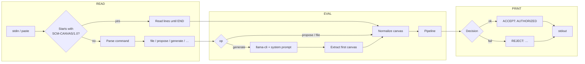
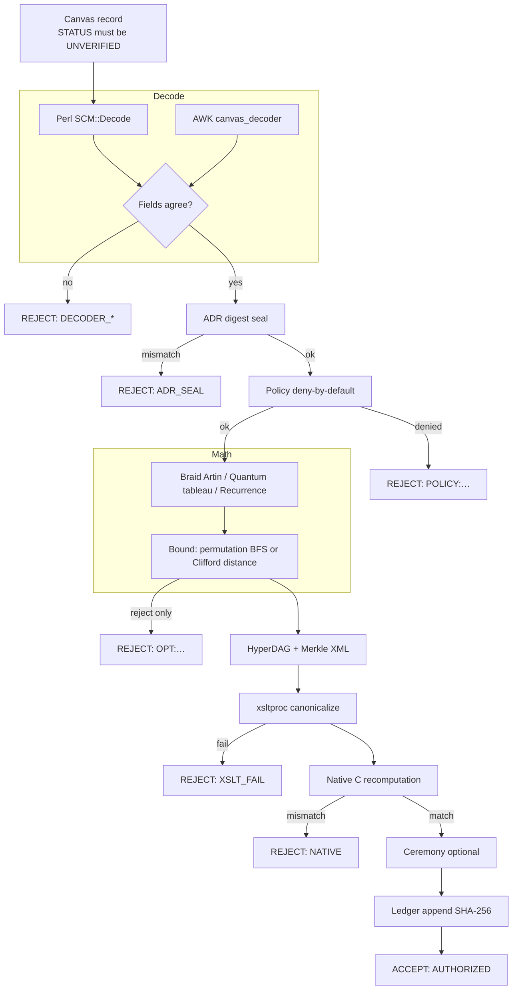
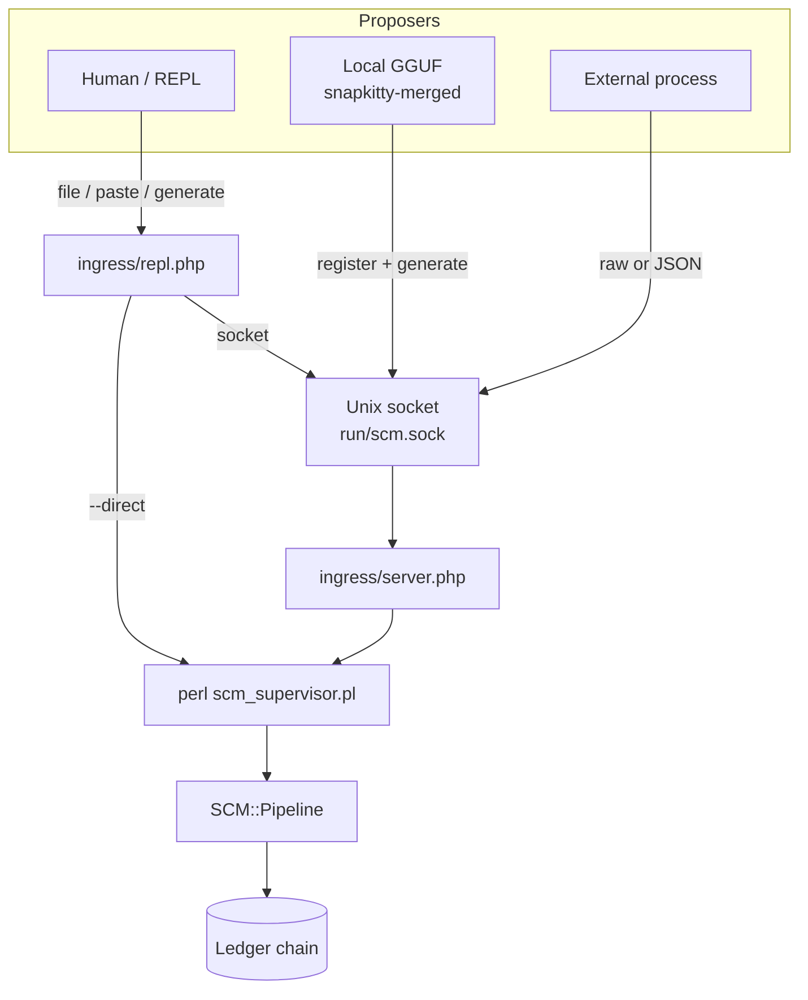
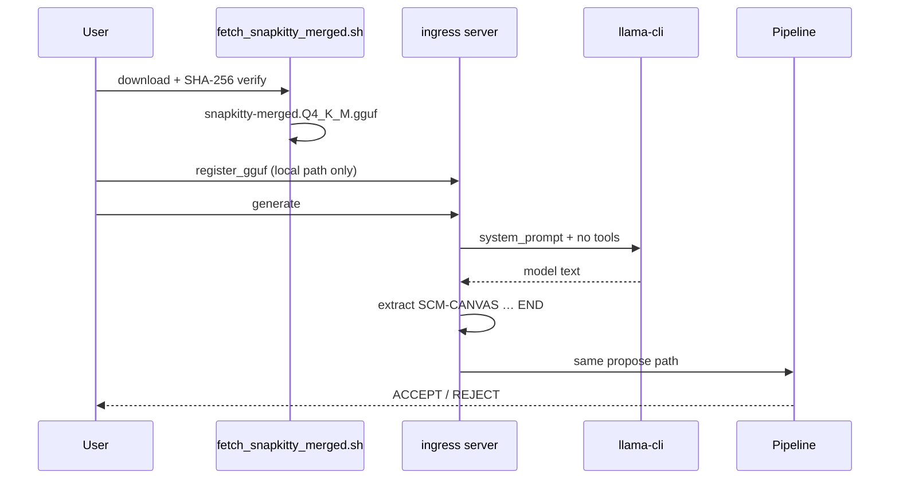

# Sovereign Canvas Machine (SCM-002)


Proof-carrying mathematical execution. A model may submit **one** typed canvas record. It does not get a shell, a tool call, or the right to mark its own work verified. Two decoders must agree. Policy is deny-by-default. A second implementation, in C, must recompute the same invariant. Only then can the ColorForth ceremony seal a hash-chained ledger line.

Copyright (C) 2026 AHMAD ALI PARR. Licensed under the GNU Affero General Public License v3.0. See [LICENSE](LICENSE).

---

## REPL demo

Interactive Read–Eval–Print loop over the pipeline (`ingress/repl.php`):


```text
scm> file fixtures/braid_valid.txt
ACCEPT: AUTHORIZED

scm> file fixtures/braid_unauthorized.txt
REJECT: POLICY:no_trusted_equivalence

scm> propose
... SCM-CANVAS/1.0
... TARGET s1 s2 s1
... CANDIDATE s2 s1 s2
... END
ACCEPT: AUTHORIZED
```

```bash
make repl                    # direct mode (no socket)
php ingress/repl.php --direct

# or with the Unix-socket server
php ingress/server.php &
php ingress/repl.php
```

### REPL commands

| Command | Action |
|---|---|
| `help` | List commands |
| `file <rel/path>` | Propose a canvas file (e.g. `fixtures/braid_valid.txt`) |
| `propose` | Multi-line paste until `END` |
| `generate [model]` | GGUF generate (default `snapkitty-merged.Q4_K_M.gguf`) |
| `register <name> <abs>` | Register a local `.gguf` |
| `models` | List registered weights |
| `ping` | Health check |
| `json {...}` | Raw JSON op |
| `quit` | Exit |

Paste a full `SCM-CANVAS/1.0` … `END` record at the prompt; the loop reads until `END` and evaluates it.

---

## What the loop is made of

### Read → Eval → Print (REPL)



### Pipeline (eval stages)



### Production ingress topology



### GGUF path (default model)



---

## Quick start

```bash
# tests (needs xsltproc + gcc)
make test                 # 104/104
make test-ingress         # socket smoke tests

# REPL
make repl

# Unix-socket server
php ingress/server.php
php ingress/client.php --file fixtures/braid_valid.txt

# Default GGUF (outside trust boundary)
./models/fetch_snapkitty_merged.sh --register
php ingress/client.php --json '{"op":"generate","model":"snapkitty-merged.Q4_K_M.gguf"}'
```

Accept prints `ACCEPT: AUTHORIZED`. Anything else is a rejection and a non-zero status.

```bash
perl perl/scm_supervisor.pl < fixtures/braid_relation.txt
perl perl/policy_enforcer.pl BRAID 's1 s2 s1' 's2 s1 s2'
perl bootstrap/run.pl bootstrap/accept_braid.cf
```

The relation fixture is the one that used to be impossible under string compare: target `s1 s2 s1`, candidate `s2 s1 s2` — the same three-strand braid. `s1 s1 s2` is not, and it is denied.

---

## What actually runs

| Stage | Where | Decision |
|---|---|---|
| Decode | `awk/canvas_decoder.awk` and `perl/SCM/Decode.pm` | Both must agree |
| ADR seal | `adr/DIGEST` | Digest mismatch rejects everything |
| Policy | `perl/SCM/Policy.pm` | Deny by default |
| Braid equality | Artin action on F3 | Faithful for B3, not string compare |
| Clifford equality | Tableau for H, X, Y, Z, S, SDG, CNOT, CZ | Up to global phase |
| Recurrence | Exact integer recomputation | Bound ±1e9 |
| Bound | Permutation BFS, or one-qubit Clifford distance | Can only reject |
| Hypergraph | `perl/SCM/HyperDAG.pm` | Diagram plus invariant |
| Projection | `xslt/canonicalize.xsl` via `xsltproc` | Terminating |
| Native check | `compcert/scm_rt.c` compiled with gcc | Must match the Perl invariant |
| Ceremony | `bootstrap/run.pl` | Skipped word is a rejection |
| Ledger | `perl/SCM/Ledger.pm` | SHA-256 chain, tamper-evident |
| Ingress | `ingress/server.php` | One propose → pipeline |
| REPL | `ingress/repl.php` | Interactive read–eval–print |

Workspaces are `BRAID`, `QUANTUM`, and `RECURRENCE`. Record format: [schemas/canvas_protocol.md](schemas/canvas_protocol.md).

---

## Production ingress & model

Unix-domain socket (PHP). One request → one accept/reject + ledger line.

- Raw canvas body or JSON: `op=propose|generate|register_gguf|ping|list_models`
- Default weights: **[Snapkitty/snapkitty-merged](https://huggingface.co/Snapkitty/snapkitty-merged)** (`snapkitty-merged.Q4_K_M.gguf`, SHA-256 verified by `models/fetch_snapkitty_merged.sh`)
- **No HTTP download inside ingress** — fetch is a separate, auditable step
- QEMU and Ollama dirs are **deprecated** fail-closed shims; isolation notes in `sandbox/`

See [ingress/README.md](ingress/README.md) and [models/README.md](models/README.md).

---

## Source present, not claimed executed here

These files are real and are not stubs. They are not claimed to have been run when the toolchain is absent:

- `lean/Kernel.lean` — Artin check for Lean 4
- `prolog/policy.pl` — deny-by-default theory
- `ampl/braid_perm.mod` — permutation bound as an integer program (executed bound is the BFS)
- CompCert-friendly C (bootstrap compiler is gcc)

---

## Boundaries

Untrusted bytes are not interpolated into a shell. Children are started with argument vectors. A proposal with `STATUS` other than `UNVERIFIED` is rejected. Paths may not be absolute and may not contain `..`. The ADR digest is checked before policy, so a silent edit of the constitution fails closed.

---

## License

GNU Affero General Public License v3.0 only. The full text is in [LICENSE](LICENSE).
