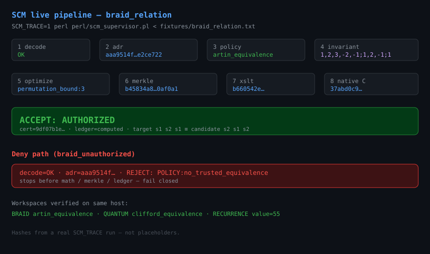
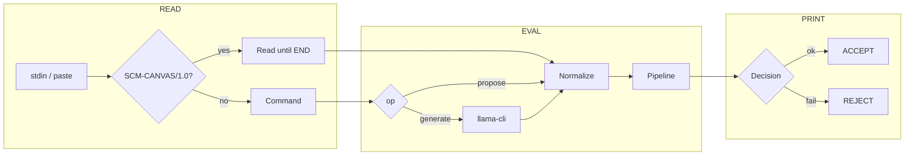
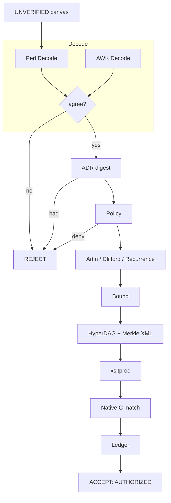
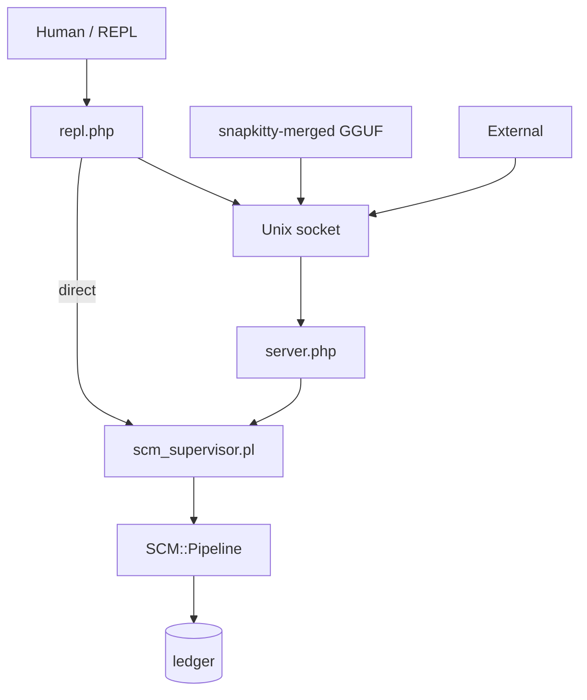

# Sovereign Canvas Machine (SCM-002)


Proof-carrying mathematical execution. A model may submit **one** typed canvas record. It does not get a shell, a tool call, or the right to mark its own work verified. Two decoders must agree. Policy is deny-by-default. A second implementation, in C, must recompute the same invariant. Only then can the ColorForth ceremony seal a hash-chained ledger line.

Copyright (C) 2026 AHMAD ALI PARR. Licensed under the GNU Affero General Public License v3.0. See [LICENSE](LICENSE).

---

## Live pipeline (real run)

> **Honest status:** Branch `production-ingress` has the code and this README.
> PNG/GIF binaries were generated locally but **not** uploaded via the text-only GitHub API.
> The diagram below is an SVG (text) so it actually renders on GitHub.

Captured from a real run:

```bash
SCM_TRACE=1 perl perl/scm_supervisor.pl < fixtures/braid_relation.txt
```



### Accept path — braid relation `s1 s2 s1` ≡ `s2 s1 s2`

```text
decode=OK
adr=aaa9514fb476eebcd62586a45ee1dc7984f3fa70b012e649f5e92c240e2ce722
policy=artin_equivalence
invariant=1,2,3,-2,-1;1,2,-1;1
optimize=permutation_bound:3
ir=bc26c51bc246a38346ce348fa1550830f8c2e415a00eaacfcce417a50064d725
merkle=b45834a8a2f6da40824701c9126b1db7c33770938c3048f17c778ac18d0af0a1
xml=22860938fd130beefc95cf197606835f7d5c7fdbe2fc4d3d2c0cd3512fa6753c
xslt=b660542e6bd5fec9a4f19cfd93ca70329e86da5af522d4695599b1bb1cc6f2b7
native=37abd0c9dbaacc884a56a10908859145ed5100f418931309c6b8e60067c70d02
cert=9df07b1e9e574269b89c0bc488dcd5233a3c35047ae12704c6cfdab5ceb9e22b
ledger=computed
ACCEPT: AUTHORIZED
```

### Deny path — inequivalent braid

```text
decode=OK
adr=aaa9514fb476eebcd62586a45ee1dc7984f3fa70b012e649f5e92c240e2ce722
REJECT: POLICY:no_trusted_equivalence
```

Policy fails closed **before** math seals or ledger append. No partial authority.

### Three workspaces (same machine)

| Workspace | Fixture | Policy reason | Result |
|---|---|---|---|
| BRAID | `braid_relation.txt` | `artin_equivalence` | `ACCEPT: AUTHORIZED` |
| QUANTUM | `quantum_cnot.txt` | `clifford_equivalence` | `ACCEPT: AUTHORIZED` |
| RECURRENCE | `recurrence_fib.txt` | `recurrence_recomputation` → `value=55` | `ACCEPT: AUTHORIZED` |

---

## REPL

```bash
make repl                         # direct → supervisor
php ingress/server.php &          # optional socket
php ingress/repl.php
```

| Command | Action |
|---|---|
| `file <rel/path>` | Propose a canvas fixture |
| `propose` | Multi-line paste until `END` |
| `generate [model]` | GGUF generate (`snapkitty-merged.Q4_K_M.gguf`) |
| `register <n> <abs>` | Register local `.gguf` |
| `models` / `ping` / `json` | Inventory / health / raw op |
| `quit` | Exit |

---

## What the loop is made of

### Read → Eval → Print



### Pipeline stages (every accept)



### Ingress topology



---

## Quick start

```bash
make test                 # 104/104
make test-ingress
make repl

php ingress/server.php
php ingress/client.php --file fixtures/braid_valid.txt

./models/fetch_snapkitty_merged.sh --register
php ingress/client.php --json '{"op":"generate","model":"snapkitty-merged.Q4_K_M.gguf"}'
```

```bash
perl perl/scm_supervisor.pl < fixtures/braid_relation.txt
perl perl/policy_enforcer.pl BRAID 's1 s2 s1' 's2 s1 s2'
perl bootstrap/run.pl bootstrap/accept_braid.cf
```

---

## Stage map

| Stage | Where | Decision |
|---|---|---|
| Decode | `awk/canvas_decoder.awk` + `perl/SCM/Decode.pm` | Both must agree |
| ADR seal | `adr/DIGEST` | Digest mismatch rejects |
| Policy | `perl/SCM/Policy.pm` | Deny by default |
| Braid | Artin action on F3 | Faithful for B3 |
| Quantum | Clifford tableau | Up to global phase |
| Recurrence | Exact integer recompute | Bound ±1e9 |
| Bound | Permutation BFS / Clifford distance | Can only reject |
| Hypergraph | `perl/SCM/HyperDAG.pm` | Diagram + Merkle |
| Projection | `xslt/canonicalize.xsl` | Via `xsltproc` |
| Native | `compcert/scm_rt.c` + gcc | Must match Perl |
| Ceremony | `bootstrap/run.pl` | Skipped word = reject |
| Ledger | `perl/SCM/Ledger.pm` | SHA-256 chain |
| Ingress | `ingress/server.php` | One propose → pipeline |
| REPL | `ingress/repl.php` | Interactive REPL |

Workspaces: `BRAID`, `QUANTUM`, `RECURRENCE`. Format: [schemas/canvas_protocol.md](schemas/canvas_protocol.md).

---

## Model

Default GGUF: **[Snapkitty/snapkitty-merged](https://huggingface.co/Snapkitty/snapkitty-merged)**  
`snapkitty-merged.Q4_K_M.gguf` · SHA-256 `4d959da2985affc363c02784307ac135a69e77768d8d5475c6f15bb99560c59f`

Fetch is **outside** the trust boundary (`models/fetch_snapkitty_merged.sh`). Ingress only accepts local paths with GGUF magic. Inference needs `llama-cli` / `SCM_LLAMA_BIN`.

---

## Boundaries

Untrusted bytes are never interpolated into a shell. Children use argument vectors. `STATUS` must be `UNVERIFIED`. Paths cannot be absolute or contain `..`. ADR is checked before policy — a silent constitutional edit fails closed. QEMU/Ollama dirs are deprecated DENY shims; see `sandbox/`.

---

## Formal sources (not required at runtime)

- `lean/Kernel.lean` — Artin check  
- `prolog/policy.pl` — deny-by-default theory  
- `ampl/braid_perm.mod` — permutation bound (executed bound is BFS)  
- CompCert-friendly C (bootstrap compiler: gcc)

---

## License

GNU Affero General Public License v3.0 only. Full text in [LICENSE](LICENSE).
